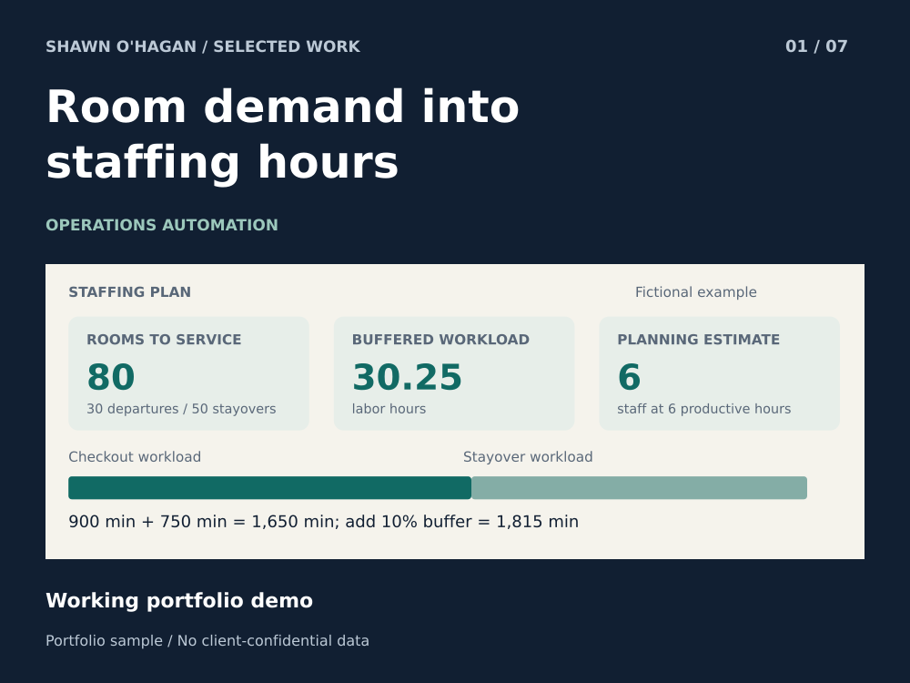

# Hotel Demand and Staffing Planner

Turn a room forecast into a staffing estimate a manager can check.

**Status:** Working portfolio demo

**Role:** Operations specialist and AI-assisted prototype designer

## The problem

A room forecast is not a staffing plan. Departures and stayovers take different amounts of work, and managers need to see the assumptions before changing a schedule.

## How the sample works

The calculator separates checkout and stayover workload, adds an adjustable planning buffer, and rounds up to whole staff. Invalid or impossible room counts are rejected.

## What you can inspect

The fictional example has 30 departures at 30 minutes and 50 stayovers at 15 minutes. With a 10% buffer, that is 1,815 minutes or 30.25 labor hours; six staff cover it at six productive hours each.

## A practical first project

A useful first project is mapping one existing room report into a repeatable staffing worksheet, with assumptions and exceptions visible.

## Scope

A deterministic planning example, not a demand prediction model, labor optimizer, or live scheduling integration.

AI-assisted portfolio demonstration using fictional operational data.

[Download the case study](01_predictive_operations.pdf)
