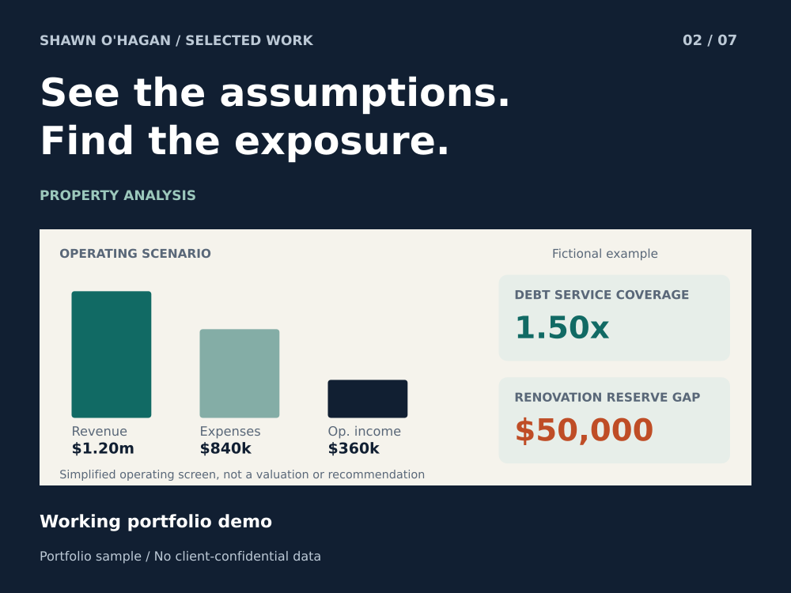

# Property Due Diligence and Operating Scenario Review

Make the operating assumptions visible before a property decision.

**Status:** Working portfolio demo

**Role:** Operations specialist and AI-assisted analysis workflow designer

## The problem

A seller packet can look complete while hiding an operating expense or renovation funding gap. A reviewer needs traceable inputs and a short list of questions to resolve.

## How the sample works

The sample separates revenue, operating expenses, debt service and renovation reserves. It returns calculated metrics and explicit exception flags instead of a one-number investment score.

## What you can inspect

$1.20 million revenue less $840,000 operating expenses gives $360,000 simplified operating income. Dividing by $240,000 debt service gives 1.50x coverage. A $150,000 renovation budget against $100,000 reserves leaves a $50,000 gap.

## A practical first project

A practical first project is organizing one property packet into an assumption register and exception report for a qualified reviewer.

## Scope

Educational operating screen only. Expense definitions must be reconciled; valuation, taxes, financing advice and investment recommendations are outside this sample.

AI-assisted portfolio demonstration using fictional financial inputs.

[Download the case study](02_property_due_diligence.pdf)
