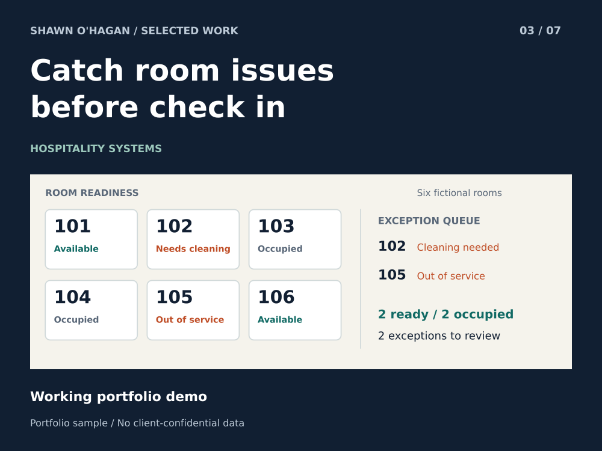

# Room Readiness and Front Desk Exception Report

Bring room status disagreements into one review queue.

**Status:** Working portfolio demo

**Role:** Hospitality workflow specialist and AI-assisted prototype designer

## The problem

Front desk and housekeeping can each have a plausible status for the same room. Staff need the disagreement surfaced before a guest is assigned to a room that is not ready.

## How the sample works

Each record is checked for a unique room ID and valid states. A vacant, clean room is available; a dirty or out-of-service room enters the exception queue. Occupied rooms remain occupied.

## What you can inspect

Of six fictional rooms, 101 and 106 are available. Rooms 103 and 104 are occupied. Room 102 needs cleaning; room 105 is out of service. The original inputs are left unchanged.

## A practical first project

Start with a read-only export comparison: agree on room-state mappings, generate a discrepancy list, and let a manager approve any corrections.

## Scope

A standalone reconciliation sample, not the full FrontDesk Lite PMS or an integration that edits room inventory.

AI-assisted portfolio demonstration with fictional room records and no guest data.

[Download the case study](03_property_management.pdf)
