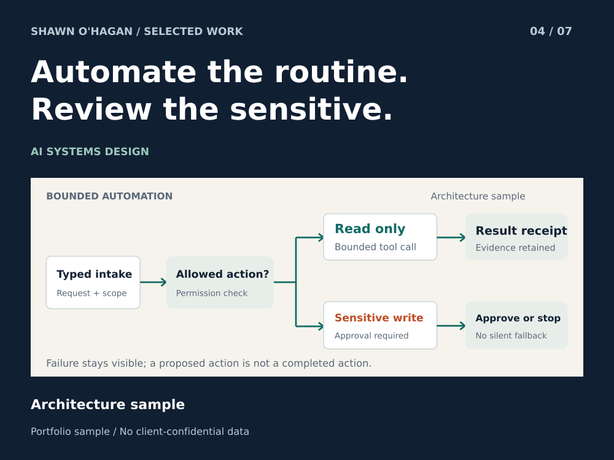

# AI Task Routing and Human Approval Workflow

Define what can run, what needs approval, and what gets recorded.

**Status:** Architecture sample

**Role:** AI workflow architect and operations specialist

## The problem

A useful automation needs to know when it is allowed to act. Otherwise a simple request can become an unreviewed record change, repeated action, or result nobody can explain.

## How the sample works

Intake records the request and allowed scope. Read-only tasks may proceed through a bounded tool call. Sensitive writes wait for approval. Every route ends with an outcome or a visible exception.

## What you can inspect

The included action contract names an input reference, allowed action, approval state, idempotency key and result reference. Timeout, invalid input and denied approval each have a defined stop condition.

## A practical first project

Begin with one read-only reporting workflow. Add a write step only after the approval rule, audit record and recovery behavior have been agreed.

## Scope

A public architecture example. No production reliability benchmark, live connector execution or proprietary AES implementation is represented.

AI-assisted design sample based on an operations-led approach to automation.

[Download the case study](04_ai_workflow.pdf)

## Action Contract and Failure Handling

A small public specification for a read-only exception report. The record below describes a demonstration request; it is not a receipt from a live system.

### Example action contract

|Field|Example value|Purpose|
|---|---|---|
|request_id|DEMO-001|Identify the task without exposing a user or customer.|
|input_ref|fictional_room_snapshot|Identify the approved input record.|
|allowed_action|read_only_report|Exclude changes to business records.|
|approval_state|not_required_for_read|Record why this read can proceed.|
|idempotency_key|demo_snapshot_v1|Prevent accidental duplicate work.|
|result_ref|null until produced|Never substitute a planned result for an observed one.|
|status|proposed|Change only after the action outcome is observed.|

### Stop conditions

|Condition|Required response|
|---|---|
|Invalid input|Return a validation error and leave source records unchanged.|
|Permission denied|Stop and identify the missing authority; do not choose another write path.|
|Tool timeout|Return an exception with retry eligibility; do not report success.|
|Sensitive write requested|Require an explicit approval record before execution.|

A design contract, not a security certification. A production implementation needs authentication, concurrency controls, audit storage and recovery tests.
