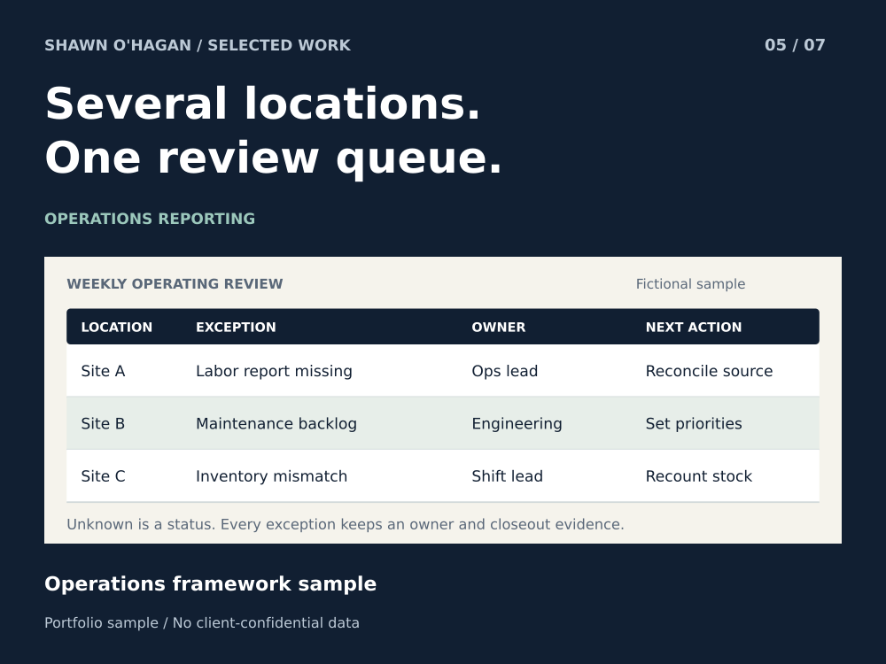

# Multi Site Operations Review and Action Tracking

Turn location updates into a review that ends with assigned actions.

**Status:** Operations framework sample

**Role:** Former General Manager and Director of Operations

## The problem

Regional reviews become slow when every location reports in a different format. Important issues disappear inside long updates, and follow-up gets lost between meetings.

## How the sample works

Use a consistent reporting cadence and an explicit unknown state. Review exceptions first. Each action records a location, issue, owner role, due date and evidence needed for closure.

## What you can inspect

The fictional review distinguishes a missing labor report at Site A, a maintenance backlog at Site B, and an inventory discrepancy at Site C. These are different problems with different owners; none is treated as a completed task.

## A practical first project

A practical first project is a weekly operating-review template and action tracker for a small group of locations, followed by one reporting-cycle review.

## Scope

Representative management framework based on professional experience; example records are fictional, with no quantified employer results claimed.

Professional operations experience presented through an AI-assisted, fictional sample.

[Download the case study](05_multilocation_operations.pdf)

## Weekly Review and Action Register

Three fictional locations show how incomplete reporting, maintenance issues and stock discrepancies become distinct follow-up actions. No item is marked complete without evidence.

### Sample action register

|Location|Issue|Owner role|Review due|Closure evidence|
|---|---|---|---|---|
|Site A|Labor report missing|Operations lead|Before next weekly review|Reconciled source report with date and reviewer.|
|Site B|Maintenance backlog|Engineering lead|Next daily review|Prioritized work list; urgent items escalated.|
|Site C|Inventory mismatch|Shift lead|Before next stock order|Recount record and approved adjustment, if needed.|

### Reporting cadence

|Cadence|Review|Output|
|---|---|---|
|Daily|Immediate service blockers and safety escalations|Owner, next action and escalation route.|
|Weekly|Missing reports, recurring variance and overdue actions|Exception summary and action register.|
|Monthly|Repeated causes and process changes|Procedure update or targeted training need.|

### Record states

|State|Meaning|
|---|---|
|Unknown|Source missing or not reconciled; never treat as a favorable result.|
|Open|Issue confirmed and an owner assigned.|
|Pending review|Work reported complete, with evidence awaiting review.|
|Closed|An authorized reviewer accepted the closeout evidence.|

The framework reflects multi-location operations experience. Sample issues, locations and records are fictional.
