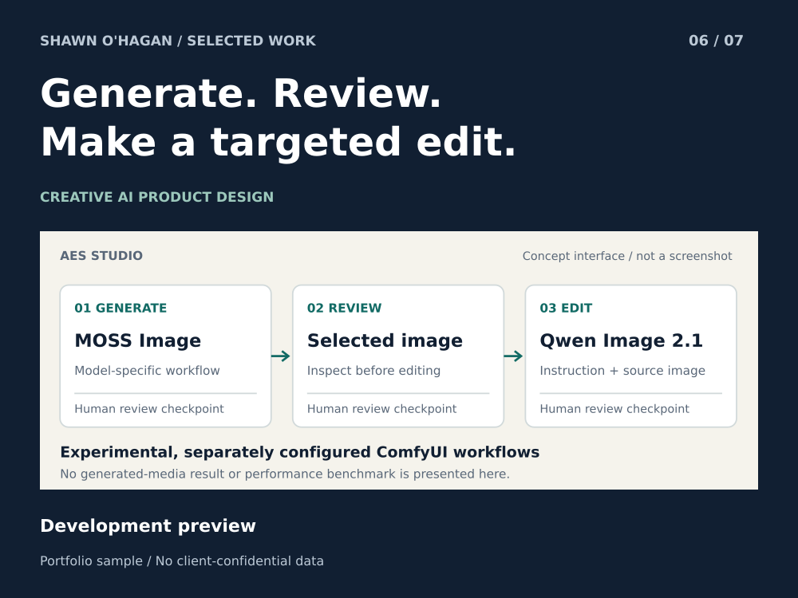

# AES Studio MOSS and Qwen Image Workflow Showcase

A focused public view of the MOSS Image and Qwen Image 2.1 workflow.

**Status:** Development preview

**Role:** CTO and AI product workflow designer

## The problem

Creative work stalls when users cannot tell which workflow is running, which asset is being edited, or what settings produced the result they liked.

## How the sample works

Keep generation, review and editing as separate decisions. The scoped flow uses MOSS Image for generation and Qwen Image 2.1 for editing, with an explicit handoff of the selected image.

## What you can inspect

Current source documents experimental templates for these two workflows. The concept interface makes inputs, workflow identity and output review visible. It contains no fabricated generated image or performance metric.

## A practical first project

A suitable first project is designing a narrow model-specific workflow and its interface, then validating it against the client's installed environment.

## Scope

Experimental external ComfyUI workflows require separate models and nodes. Native universal support, training integration and fresh model-run results are not claimed.

AI-assisted concept interface grounded in current project source; no model run performed for this showcase.

[Download the case study](06_aes_studio.pdf)
