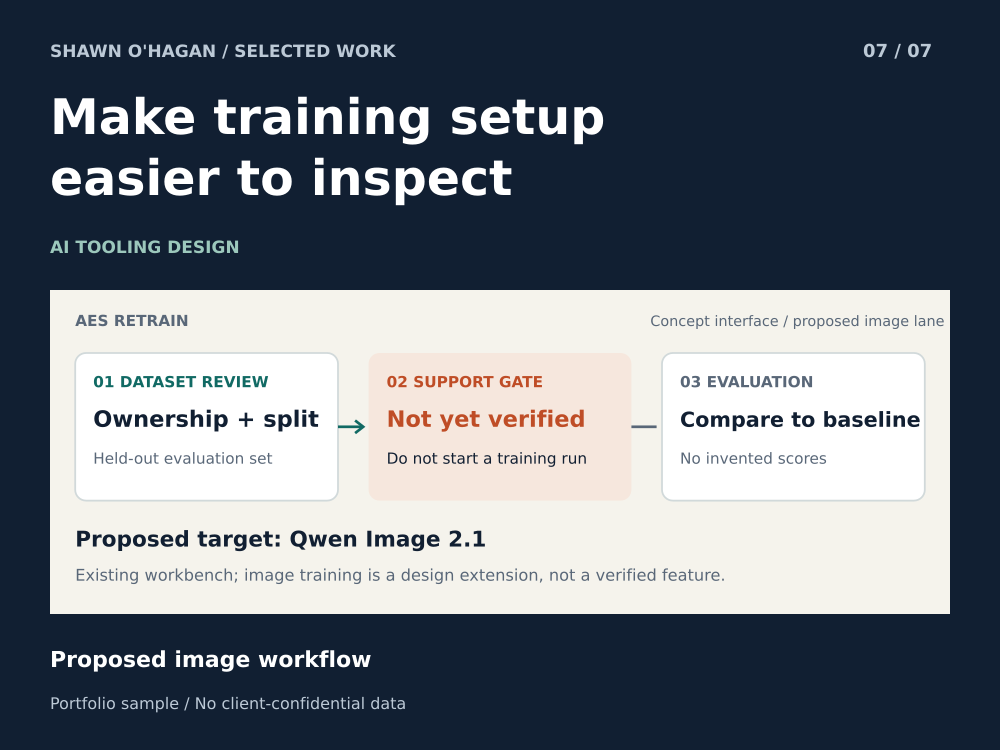

# AES ReTrain Image Training Workflow Design

A scoped image-training extension design for an existing workbench.

**Status:** Proposed image workflow

**Role:** CTO and model workflow designer

## The problem

Training tools can make a configuration look ready before its data, target architecture or execution path has been checked. A run button should not conceal those uncertainties.

## How the sample works

The proposed image lane separates dataset review, target-support checks, run configuration and held-out evaluation. Unverified compatibility blocks execution rather than becoming a silent assumption.

## What you can inspect

The existing ReTrain workbench provides the product context. This sample adds an image-lane design and evaluation rubric, not a new model-training result. A target-support gate is intentionally unresolved until implemented and tested.

## A practical first project

Begin with dataset intake and evaluation requirements for the specified target. Confirm a compatible training path before offering execution or performance commitments.

## Scope

Qwen Image 2.1 is the proposed target here. MOSS training support is not asserted. Broader model names, recipes, weights and private datasets are excluded.

AI-assisted design extension; the image-training lane remains proposed.

[Download the case study](07_aes_retrain.pdf)

## Image Lane Readiness and Evaluation

A proposed Qwen Image 2.1 evaluation lane for the ReTrain workbench. This specification does not enable a training runner or establish target compatibility.

### Readiness before any run

|Gate|Evidence needed|
|---|---|
|Dataset rights|Ownership or permission for every source; exclude private customer material.|
|Dataset separation|Deduplication and a held-out evaluation set, separated before training.|
|Target compatibility|An implemented, documented runner for the exact target architecture.|
|Resource plan|Observed dry-run checks and an explicit compute/storage budget.|
|User confirmation|Approval for the bounded experiment after readiness checks pass.|

### Evaluation rubric without invented scores

|Criterion|Comparison|Acceptance rule|
|---|---|---|
|Prompt adherence|Baseline and candidate on held-out prompts|Agree the review standard before the run.|
|Visual consistency|Fixed settings and a balanced set of views|Record regressions and inconsistent examples.|
|Artifact rate|Blinded review of generated outputs|Count failures against a predefined rubric.|
|Reproducibility|Repeat the recorded configuration|Retain model version, settings and run evidence.|

Support status: Qwen Image 2.1 training remains proposed in this showcase. MOSS training support is not asserted. No accuracy, quality or speed score is supplied.
